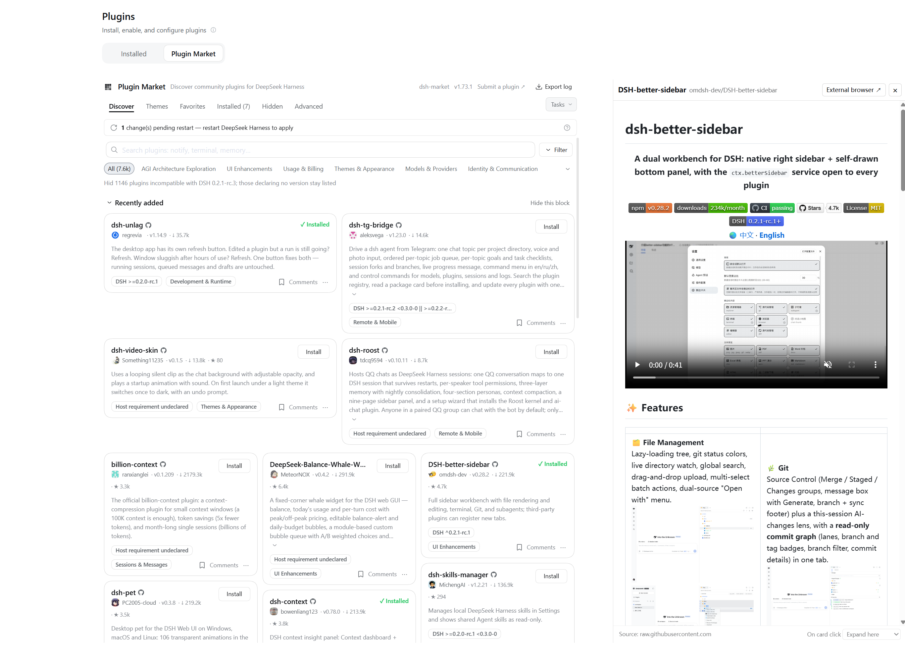

# dsh-market-peek

English · [中文](README.md)

Clicking a plugin card in the DeepSeek Harness plugin market **no longer jumps to an external browser** — the plugin's details open inside DSH.



## Features

- **Full-page market**: a panel docks on the right of the market and shows the plugin's README. It does not cover the market; the market narrows to make room.
- **Market opened from a conversation** (right Sidebar available): the repository opens in DSH's built-in browser in the right Sidebar. Clicking more cards reuses the same tab.
- **Restored on leave**: when you switch to another page or conversation, the panel closes, the market gets its width back and the preview tab is closed; a right Sidebar that was collapsed collapses again.
- Clicking the plugin title or a blank part of the card triggers it; install, favourite and comment buttons keep their original behaviour.
- The panel's footer switches the click behaviour between **Expand here** (default) and **External browser**.
- Ctrl / Cmd / Shift / Alt-click still opens the external browser.
- Drag the panel's left edge to resize it (remembered); close it with Esc or ×.

## Install

Search for `dsh-market-peek` in the DSH plugin market and click Install, or:

```sh
dsh plugin add github:LyuYuxin/dsh-market-peek
```

## Notes

- The README is fetched from the GitHub API (rendered), then raw.githubusercontent.com, then the jsDelivr mirror.
- It is shown in a sandboxed iframe without script permission: content is displayed, never executed.
- Cards are recognised by the market's CSS class names; if a market update breaks clicking, please open an issue.

## License

MIT
